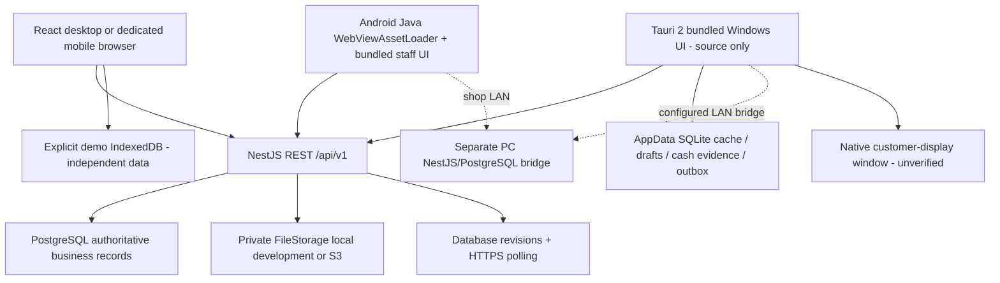

# TAHA POS — complete project handoff

**Subsequent same-day implementation:** PhaseR1 recovered the corrupted backend and established fresh regression/backup/source-control work. This document records the pre-recovery audit findings. Read `TAHA_POS_PHASE_R1_RECOVERY_REPORT.md` and the updated remaining-work/Hostinger reports before treating its broken-backend or unknown-plan statements as current.

Audit date: **11 November 2026, Asia/Karachi**. Project root: **`D:\Inventory system POS`**. Business: **TAHA MOBILES**. Applications: **Taha POS** and **Taha Staff**. Currency: **PKR**.

This is an investigation, not a development or deployment phase. Application source was not repaired, redesigned, upgraded or reset. Only audit documents, evidence and normal build/test outputs were written. No services were purchased, no cloud resources created, no customer messages sent and no shop database migrated. Isolated test PostgreSQL was started for disposable tests; the saved development database was not started or used.

## 1. Executive state

**The project is substantial, but NOT ready for daily shop use and NOT currently reproducible as a complete working API.**

The immediate blocker is a corrupted source file: `server/src/media/media.service.ts` contains **33,538 zero bytes**. Fresh backend TypeScript, lint and build fail on it. It is imported by the Nest application, media controllers and camera workflows. The corruption's cause is **unknown**. Its last-write timestamp is 29 October 2026 15:27:18; this does not establish when or why its contents were lost. Do not attribute it to a particular tool or person without evidence.

Frontend TypeScript/lint/build pass. Current focused browser, SQLite, Android JVM and direct PostgreSQL domain tests pass within their scopes. This does not cancel the backend blocker. No Windows EXE/installer exists in the inspected output paths. The latest Android delivery is an older debug-signed test APK, not a newly built production release. No live Taha cloud deployment, managed PostgreSQL or object bucket was verified.

The most recent development was **Phase 6A cloud preparation on 29 October**, interrupted before full regression, account/resource provisioning, deployment and final handoff. The initial Phase 6A report understates the source changes now present. No separate implemented Phase 5D.3 was found.

### Evidence vocabulary

- **WORKING — VERIFIED:** an identified automated check or read-only reproduction passed; its environment is stated.
- **IMPLEMENTED — NOT FULLY TESTED:** substantive source exists, but current end-to-end/native/hosting acceptance is absent.
- **PARTIALLY WORKING:** a real implementation has known gaps or unsupported paths.
- **BROKEN:** current reproducible failure.
- **NOT IMPLEMENTED:** no complete workflow found, or deliberately rejected by the application.
- **NOT APPLICABLE:** outside the relevant architecture or intentionally unnecessary.

Every API-backed feature below shares the current API build blocker. A database-only pass is not an HTTP, physical-device or hosted-production pass.

## 2. Repository, versions and runtime

| Item | Verified state |
|---|---|
| Git branch/latest commit | **Unavailable.** `git status --short --branch` and `git log` both report not a Git repository. No `.git` history is available here. |
| Modified/untracked diff | Cannot reconstruct without a baseline. File timestamps and reports establish recent file groups, not commits or exact historical diffs. No existing work was discarded. |
| Last substantive inspected source timestamps | 29 October, ending with media source/test changes around 15:27. No later application phase was established from the inspected source/report inventory. |
| Root package / Tauri product | `taha-pos` **0.5.0**; Tauri product version **0.5.0**. |
| Backend package / health version | `taha-pos-api` **0.1.0**. These package labels are not phase milestones. |
| Installed JavaScript tools | Node **22.23.1**; TypeScript **5.9.3**; React **19.3.0**; Vite **7.3.6**; Nest core **11.2.7**; backend `pg` **8.23.1**. Package manifests use ranges, so these differ from some older prose. |
| Android source/delivered version | Source `0.5D.2`, versionCode **10**; delivered debug artifact `0.5D.2-test`, code **10**. |
| Windows tools | Rust/Cargo **1.99.0**, MSVC target installed; actual MSVC C++ workload/Windows SDK not found. |
| At audit start | No Taha Vite/API/PostgreSQL listeners on 1423, 3001, 3003, 3306, 3443, 4174, 55439 or 55459. Other Node processes belonged to the tooling; they were not restarted/killed. |
| Fresh local reachability | Frontend1423 and health on3001/3003 were not reachable. The audit did not start the broken shop API or owner database. |
| Isolated audit database | Existing test cluster `.test-postgres/phase5c-20261014/pgdata`, PostgreSQL **17.11**, loopback **55459**. Crash recovery completed before test execution. This is not the shop database. |
| Saved local development database | Loopback **55439**, database `taha_api_browser_1791211953496`, private configuration in ignored `server/.env.mobile-test`. Not opened, reset or migrated by this audit. |

Fresh frontend gate timestamps: **12:50:59–12:56:38 PKT**. Fresh backend failed gates: **12:51:34–12:54:25 PKT**. Detailed logs and other test timestamps are under `.test-postgres/audit-20261111/`.

### Most recent important source additions/changes

29 October source groups, identified from content and timestamps:

- Backend cloud runtime: `server/src/config.ts`, `database/pool-options.ts`, `database/database.service.ts`, `app.module.ts`, `main.ts`, `function-handler.ts`, `realtime/polling.gateway.ts`, `health.controller.ts`.
- Deployment: `server/api/index.js`, `server/vercel.json`, `server/.vercelignore`, `server/.env.vercel.example`, `scripts/configure-vercel-frontend.mjs`, `scripts/build-cloud.mjs`, `scripts/cloud-frontend-config.mts`.
- Frontend cloud/mobile: `src/main.tsx`, `src/app/app.tsx`, `src/features/mobile/mobile-routes.tsx`, `mobile-settings-page.tsx`, `mobile-shell.tsx`, `src/components/layout/deployment-indicator.tsx`, `src/styles/staging.css`, `src/lib/device-bridge/realtime.ts`.
- Media: `server/src/media/file-storage.ts`, `media.controller.ts`, corrupted `media.service.ts`, `src/lib/api/media.ts`, `direct-upload.ts`, upload-grant migration and tests.
- Staging seed: `server/scripts/seed-staging.ts`, migration `202610290000_staging_dataset.sql`; private upload grants in `202610290100_cloud_uploads.sql`.
- Local startup: `scripts/local-service-ports.mjs`, `start-local-acceptance.mjs`, `server/scripts/local-acceptance-api.ts`, fixture `serve-test.ts`.

The managed ZIP `artifacts/managed/Taha-API-managed-0.5.0.zip` is dated **8 October**, 399,053 bytes. It predates the later service, enrollment, receipt and cloud changes. It is not the current deployment package or a complete Phase6A rollback.

## 3. Verifiable development history and interruption

| Date | Work and evidence | Completion boundary |
|---|---|---|
| 8 Oct | Phase5A Windows foundation, SQLite/outbox, DPAPI/session and managed-hosting preparation; `PHASE5A_IMPLEMENTATION.md`, `PHASE5A_WINDOWS.md`, `PHASE5A_SECURITY.md`, `HOSTINGER_DEPLOYMENT.md`. | Native build blocked; no installer or hosting acceptance. |
| 14–15 Oct | Phase5C smart material services, damaged/quarantine stock, classified returns, customer activity/ledger, receipt lookup and due reminders. `PHASE5C_IMPLEMENTATION.md`, migrations140100–140500 and hardening150100. | Real local/API/SQL work, with documented browser/hardware boundaries. |
| 15 Oct | Phase5C.1 immutable paid-cash evidence, owner reconciliation/refund/posting, cross-employee recovery, lost-ack/restart reliability and browser cold-start test stabilization. `PHASE5C1_IMPLEMENTATION.md`, SQLite002 and SQL150200. | SQLite/isolated integration evidence; installed Windows acceptance still absent. |
| 16–17 Oct | Phase5D functional/UI checks and Android test delivery. `PHASE5D_UI_FUNCTIONAL_ACCEPTANCE.md`, `PHASE5D_ANDROID_TEST_DELIVERY.md`. | Test APK/local checks, not production launch. |
| 21–22 Oct | Phase5D.1 customer workspace, shop configuration, catalog values, detail/history, mobile improvements. `PHASE5D1_IMPLEMENTATION_AND_ACCEPTANCE.md`, customer/mobile notes, SQL210100–210130. | Superseded in part by later revised5D.2 integration. |
| 22 Oct | Revised5D.2 Discord-style material token composer, compound product/labor accounting/returns, protected companion enrollment, neutral-gray themes, compact product toolbar and opaque receipt references. `PHASE5D2_REVISED_IMPLEMENTATION.md`; SQL220140–220400. APK build10. | Historical176backend/164browser+1skip/24Android; explicitly ready for physical retest, not daily production. |
| 29 Oct | Phase6A Vercel/cloud browser, bounded PostgreSQL pool, no-socket cloud gateway, function handler, direct object upload, isolated seed and safe local port selection. Actual source and logs exceed initial readiness report. | Some focused green runs; final full backend log stops after23tests without TAP completion. Final frontend build log is empty. Media last integration log has no full summary. No deployed URL acceptance. |
| 11 Nov | This audit: source/artifact inspection and safe tests, three requested handoff documents plus evidence notes. | No repairs, deployment, purchase or feature implementation. |

**No Phase5D.3 report, spec, test or separately identified implementation was found** in inspected docs/src/tests/scripts/package metadata. Some requested corrections remain outstanding. Do not invent a completed5D.3 milestone.

At interruption the intended next work was: integrate/freeze frontend and media changes, finish full regression and security review, finish Phase6A deployment/demo reports, identify an approved commercial Vercel team plus PostgreSQL/private storage, then deploy/test real HTTPS. That sequence never reached verified resource provisioning or hosted acceptance in the retained evidence. The corrupt source now precedes all further deployment work.

## 4. Actual architecture and source map

Cloud boxes describe a prepared target, **not verified hosted resources**. LAN and cloud do not share credentials/state automatically. SQLite and demo IndexedDB are different authorities.

| Directory | Responsibility / entrypoints |
|---|---|
| `src/bootstrap.ts`, `main.tsx`, `app/` | Branded boot, providers, authenticated lazy routes, error boundary; `App`, `MobileApp`. BrowserRouter for browser; HashRouter for packaged/native contexts. |
| `src/components/` | Approved shell, POS, charts, forms, custom dropdown/date/checkbox primitives, dialogs, receipts and customer display. |
| `src/features/` | Dashboard, sales, inventory, customers/credit, services/repairs, purchasing, employees, reports, settings and dedicated mobile pages. |
| `src/stores/` | Zustand cart, session, UI, camera/device/shop connection and sync state. TanStack Query supplies request caching/invalidation. |
| `src/styles/` | Tailwind4 plus existing CSS/token design system; bundled Manrope/Inter, light default, charcoal/gold/red neutral themes and reduced motion. Radix, Framer Motion, Lucide. |
| `src/lib/repositories/` | Common interfaces/composition. Pages use repositories rather than directly manipulating the database. |
| `src/lib/local/` | Dexie/IndexedDB demo transactions and local business adapters. Demo data is isolated to that browser. |
| `src/lib/api/` | REST repositories, memory access tokens, refresh/counter client, safe media and revision polling. |
| `src/lib/desktop/`, `src-tauri/` | Native IPC/HTTP, SQLite, offline context/cash reconciliation, local images, DPAPI and windows. |
| `src/lib/mobile/`, `mobile/android/` | Mobile transport/cache/drafts/capture queue; Java native camera/scanner/security/pairing bridge. |
| `src/lib/device-bridge/` | Independent terminal/phone pairing and device/camera service; not tied to local business repositories. |
| `server/src/` | Nest auth, business operation allowlist, workflows, inventory/sales SQL access, camera, display, media, sync/reconciliation and receipts. |
| `server/migrations/` | Compatibility schema, imported legacy migrations, custom auth/financial/inventory/sync/current changes. Checksummed explicit migration runner. |
| `server/test/`, `tests/`, `scripts/test-*` | Node/PostgreSQL/API, Playwright browser, SQLite and legacy compatibility tests; not all commands are pure/unit-only. |
| `docs/`, `.test-postgres/`, `artifacts/` | Requirements/historical reports/screenshots, test evidence/private DB fixtures, delivered test artifacts. These are not all safe to publish. |

### Provider boundaries and Supabase

`src/lib/config.ts` and repository composition select **local**, **api**, or explicitly legacy **supabase**. Native production selects API. Cloud build guards require API and real auth. Device Bridge can use the custom API even when business data uses local/demo repositories.

The intended production engine is custom NestJS/PostgreSQL; no Supabase service is required. **Supabase has not been completely removed from the code/package/bundle**: `@supabase/supabase-js`, `src/lib/supabase/`, `supabase/migrations/`, explicit legacy mode and a `supabase-vendor` chunk remain. The fresh ordinary desktop build emitted that chunk (~222.8kB). Compatibility schemas named `auth` and `storage` in custom PostgreSQL are not proof of a hosted Supabase dependency. Final package cleanup must preserve imported SQL and tests; do not restore Supabase as the production service.

### Backend and database

Nest11/Express, TypeScript, direct **node-postgres**, no Prisma/TypeORM. `BusinessService` maps fixed operations to PostgreSQL functions; it does not accept arbitrary SQL/function names from clients. Core logic uses PL/pgSQL, SECURITY DEFINER/search_path, RLS, transaction-local identity/role, immutable stock/financial ledgers, row/advisory locks, UUID/jsonb, partial indexes, upsert/RETURNING, triggers and sequences. PostgreSQL must be preserved.

REST modules include authentication/PIN/session/device enrollment; products/costs/catalog values; locations/receiving/transfers/adjustments/conditions; sales/returns/credit/payments/coupons/approvals; customers/activity/reminders; repairs/used devices/suppliers/shifts; settings/reports/audit; media/camera/display; sync/cash reconciliation; receipt capabilities and health. Development Swagger is `/api/docs`, production disabled. `server/docs/API.md` is substantive; some top-level READMEs retain obsolete ports/APK/phase descriptions.

Local gateway uses authenticated Socket.IO `/counter` rooms and heartbeat. Cloud `TAHA_RUNTIME=cloud` substitutes `PollingGateway`, skips LAN listeners/timers and relies on persisted device heartbeat/jobs plus REST. Business revision polling is4seconds visible/30seconds hidden, with resume/retry and retained cursor. **Pure repair-job/shift changes are missing from cloud revision coverage**. Camera requests have their own poll path; `hasDevicePresence=false` alone does not make phones offline, because DB heartbeat is primary.

### Where records and images currently live

- Saved development PostgreSQL is local on55439. No hosted PostgreSQL endpoint or resource was verified. New audit financial fixtures were on55459 only.
- Windows design uses per-user AppData `counter.sqlite3`, not Program Files. Actual installed native database behavior is unverified because no native build exists.
- Demo records live in Dexie/IndexedDB per browser. They do not synchronize between PCs or become shop records automatically.
- Private local media directories exist at `server/data/media` and `server/data/local-acceptance-media`. The private saved dev environment still points at an old Windows Temp media directory, which is now absent. The standard launcher calls `prepareLocalMedia()` and uses the persistent local-acceptance destination, merging verified readable files without deleting source. This cannot recover bytes already missing.
- A previous report recorded130metadata rows lacking original media bytes. This audit did not query current owner DB media metadata or recover originals; that130is historical, not a fresh missing-file count.
- S3 abstraction and direct-upload schema/controller/transport exist. No real bucket/credentials/provider acceptance was verified. Grant authorization/completion implementation is unavailable in the corrupted MediaService. Do not call cloud media complete.

## 5. Feature-by-feature inventory

### Dashboard and reporting

| Feature | Classification | Evidence / missing acceptance |
|---|---|---|
| Sales, cash collected, digital payments, credit, gross profit | IMPLEMENTED — NOT FULLY TESTED | Actual SQL/API/dashboard projections, date range and offline-cash distinctions; historical transaction/report tests. No fresh live HTTP reconciliation today. Gross profit is not expense-adjusted net profit. Unknown costs suppress complete profit instead of fabricating zero cost. |
| Low stock, recent activity, credit reminders | IMPLEMENTED — NOT FULLY TESTED | Actual records/permission-based links in dashboard and activity helpers; historical browser assertions. POS damaged count remains absent. |
| Charts/date filters/clickable summaries | IMPLEMENTED — NOT FULLY TESTED | `dashboard-page`, chart components, `dashboard-actions`; historical chart arithmetic/links/theme checks. No fresh loaded owner dashboard visual run. |
| Full inventory/financial exports | PARTIALLY WORKING | API inventory report explicitly unavailable; API Sales CSV is a labelled recent-receipt export capped at25. No complete production spreadsheet import/export acceptance. |

### Sales and checkout

| Feature | Classification | Evidence / limits |
|---|---|---|
| Product/alias search | PARTIALLY WORKING | Exact names/aliases work; freshly reproduced ordinary1/2/3-character prefix failure and partial-code limitations. Some views omit configured dictionary. |
| HID/manual/native barcode | IMPLEMENTED — NOT FULLY TESTED | Keyboard scanner/manual search hooks and native decoder tests. Actual USB scanner/phone recognition still physical gates. |
| Customer selection/recent/quick add | IMPLEMENTED — NOT FULLY TESTED | Current Sale selector and customer repository/dialog flows; historical browser/API tests. |
| Custom/saved linked services | PARTIALLY WORKING | Real structured token, material allocations, one customer charge and saved templates. Short-search/blank presentation/unlink defect below. |
| Product/labor accounting, floors, compound returns/idempotency | WORKING — VERIFIED at SQL level | Fresh12test PostgreSQL run includes compound allocation/floor/approval/tax/returns and seed assertions. Does not restore current HTTP runtime. |
| Price override/bargaining/discount/coupons | IMPLEMENTED — NOT FULLY TESTED | SKU-bound manager approval, reason/floor and SQL policies; current subset verifies linked floors/tax/coupons. Full ordinary checkout regression not rerun. |
| Cash/split/credit payments | IMPLEMENTED — NOT FULLY TESTED end-to-end | Atomic engine, ledger and historical isolated API coverage; fresh seed commits cash/credit/partial collection. |
| Bank/JazzCash/Easypaisa/proof | IMPLEMENTED — NOT FULLY TESTED | Configured methods, staff-confirmed evidence and receipts. No actual gateway settlement/automatic refund integration is claimed. |
| Invoices/Customer Display | IMPLEMENTED — NOT FULLY TESTED | Customer-safe receipt projections, display capabilities/local state and native window source. Live hosted/second-screen acceptance pending. |

### Inventory

| Feature | Classification | Evidence / limits |
|---|---|---|
| Product create/edit/archive/duplicate | IMPLEMENTED — NOT FULLY TESTED | Actual API/local repositories, validation, optimistic edit checks. Historical real API desktop/mobile creation/receiving. |
| Gallery/batch/crop/reorder/primary/mobile capture | PARTIALLY WORKING; current API BROKEN | Frontend/media schema/controller/storage and older tests exist; lost originals and corrupt MediaService block current acceptance. |
| Category/brand/model/grade/color/variant/aliases | IMPLEMENTED — NOT FULLY TESTED | Catalog values, editor and separate tracked variant rows. No automatic combinatorial variant matrix is implied. |
| Purchase cost/selling/minimum | IMPLEMENTED — NOT FULLY TESTED end-to-end | Separate protected financials, unknown cost preserved, pricing policy and SKU-bound approvals. |
| Available/damaged/Out for Test | IMPLEMENTED — NOT FULLY TESTED end-to-end | Separate conditions/movements, test issuance/return/conversion. Fresh compound returns verify classified material restoration; POS lacks damaged badge. |
| Rack→Shelf→Box/receiving/transfer/adjust | IMPLEMENTED — NOT FULLY TESTED end-to-end | SQL conservation/stock validation, persistent locations and movement history. Physical stock/scanner acceptance pending. |
| Returns/recover/write-off/low stock | IMPLEMENTED — NOT FULLY TESTED end-to-end | Classified returns, private damaged lots/disposition history, recovery/write-off/source control. Returns UX gaps remain. |
| Spreadsheet bulk import/export | PARTIALLY WORKING | Local/demo import and limited exports are not a complete API import pipeline. |

### Customers, finance and repair shop

| Feature | Classification | Evidence / limits |
|---|---|---|
| Profiles/individual-business/limits/due dates | IMPLEMENTED — NOT FULLY TESTED | Actual customer/account settings, shop-time handling and server policy. |
| Activity/ledger/partial collections/reversals/return history | IMPLEMENTED — NOT FULLY TESTED end-to-end | Source-linked immutable financial events and permission filtering; fresh seed validates outstanding2600after3600credit/1000collection. |
| WhatsApp reminders/Copy Message/Open WhatsApp/overdue alerts | PARTIALLY WORKING | Manual prepared/opened history, encoded contacts/text and alerts exist. Clipboard fallback absent; actual receiver/browser policies unaccepted. Opening is never delivery confirmation. |
| Repair services | PARTIALLY WORKING | Saved catalog and linked service checkout exist. API cannot unlink an existing product link because validator omits explicit null. |
| Repair jobs/status/history/private photos | IMPLEMENTED — NOT FULLY TESTED | Intake/status/technician/customer workflows; current media blocker and cloud invalidation gap. |
| Parts consumed during repair | PARTIALLY WORKING | Linked-service checkout consumes stock. Merely entering a repair job does not provide a complete parts reservation/consumption/settlement workflow. |
| Repair advances/deposits/settlement | NOT IMPLEMENTED as complete repair-linked accounting | Nonzero repair advance explicitly rejected; do not treat a visible repair form as a cash ledger. |
| Used-device purchasing/IMEI/device records/suppliers | IMPLEMENTED — NOT FULLY TESTED | Real repository/SQL paths, statuses and media references. Full purchase settlement and physical serial/IMEI acceptance not established. |

### Management/system

| Feature | Classification | Evidence / limits |
|---|---|---|
| Owner-only/optional staff/permissions/PINs | IMPLEMENTED — NOT FULLY TESTED end-to-end | Operating mode, explicit permissions, backend PIN/auth/counter and scope guards. Historical auth/permission tests. |
| Shifts/closing/employee reports | IMPLEMENTED — NOT FULLY TESTED | Actual server-derived cash/refund/retained evidence and frozen close. Cloud pure-shift invalidation absent. |
| Expenses | PARTIALLY WORKING | One cash-expenses closing amount only; no full expense CRUD/category/proof/ledger or net-profit accounting. |
| Audit/settings/payment accounts/tax/receipt customization | IMPLEMENTED — NOT FULLY TESTED | Append-only audit and controlled configuration; configurable zero-default tax and immutable tax snapshots. Actual payment accounts not verified. |
| First-run setup | PARTIALLY WORKING | Compact Shop Setup exists; full ten-topic assistant is not complete. No giant new wizard is needed. |
| Themes/forms/animations | IMPLEMENTED — NOT FULLY TESTED on hardware | Neutral5D.2tokens and custom controls, historical multi-width screenshots. No current exhaustive visual review. |
| Backups/recovery/monitoring | PARTIALLY WORKING | Local dumps/manifests and procedures exist; no current automated cloud backup, alerting or tested provider restore. |

### Receipts and mobile

| Feature | Classification | Evidence / limits |
|---|---|---|
| White80mm/A4/PDF/virtual receipt | IMPLEMENTED — NOT FULLY TESTED | Existing preview/PDF/share functions and historical rendering checks; physical printer/receiver tests open. |
| Secure receipt QR/shared customer view | IMPLEMENTED — NOT FULLY TESTED | Opaque43character HMAC references, hashed lookup/expiry; legacy JWT links accepted, customer projection/CSP. No live hosted receipt domain. |
| Return/refund summaries | IMPLEMENTED — NOT FULLY TESTED | Distinguishes received/refunded/reversed/net/outstanding; return form still lacks clear resolved payout summary. |
| Printer transport | PARTIALLY WORKING | Browser/WebView printing; `WindowsPrinter` inherits it. ESC/POS interface needs a real transport/driver/hardware. No silent printing acceptance. |
| Mobile home/POS/payments/receipt/product lookup | IMPLEMENTED — NOT FULLY TESTED end-to-end | Dedicated mobile screens and ordinary staff auth. Historical real API cross-context cash/stock test; current backend blocked. |
| QR/barcode scanner | WORKING — VERIFIED in JVM scope only | Native ZXing/mode/decode tests pass; actual camera/focus/permissions/QR readability remain physical. |
| Camera/product/customer/proof/device/repair photos | PARTIALLY WORKING; API currently BROKEN | Native capture/picker/request targeting/queue exists; media source unavailable and queue recovery defect reproduced. |
| Pairing/presence/reconnect | IMPLEMENTED — NOT FULLY TESTED physically | Persistent IDs, scoped sessions, request claims, DB heartbeat/polling, local socket/reconnect and protected enrollment. |
| Mobile offline | PARTIALLY WORKING | Bundled UI, optional scoped8hour reads, drafts and retained photos. **Mobile checkout completion requires online API; no independent mobile financial outbox or phone-to-PC SQLite cash authority.** |
| Notifications/nav/settings/profile | IMPLEMENTED — NOT FULLY TESTED physically | Foreground queue/sheets/settings and optional web push source. Background push/receiver behavior is not certified. |

## 6. Smart service detail and remaining defects

`ServiceMentionComposer` (`src/components/pos/service-mention-composer.tsx`) stores surrounding text plus one explicit immutable SKU token. Deliberate candidate selection establishes linkage. Plain text alone does not deduct inventory. Keyboard arrows/Enter/Tab/Escape, token deletion, paste/copy/undo and composition guards exist. Material allocations are location/quantity validated; insertion into cart does not deduct stock.

One customer total is split into product and labor. With retail3600and charge4100, product3600/labor500; below retail produces nonnegative labor0and a product reduction, subject to normal permission/floor policy. The database records immutable product/labor/tax/cost snapshots and `REPAIR_USE` at completed checkout, using the existing idempotency/atomic transaction. Default combined-service return refunds product portion; labor refund is explicitly separately authorized. Partial credit returns preserve outstanding labor and penny/tax conservation.

**Fresh database evidence:** nine compound subtests plus their parent and two seed tests total12passes. Cases cover allocation/idempotency, nonnegative labor, floor/stale reviewed-price rollback, classified partial/final return, original-SKU approval, explicit labor refund, coupon/inclusive/exclusive tax, credit rounding and linked template current-price rules. They ran against newly created databases with current migrations, not the owner database, and did not instantiate Nest/media.

Gaps:

1. Shared `searchProducts()` rejects ordinary1/2character prefixes, and3character prefix score0.2exceeds its floored threshold0. Synthetic `v`, `vi`, `viv` fail for Vivo; `Vivo` works. `y2` fails; `y20` works. Partial codes are exact-only. This contradicts suggestions-from-first-character acceptance.
2. Mention/mobile/global search omit the saved shop dictionary. Product-specific aliases work; composer has special `panal`/`panl` replacement, not universal fuzzy support.
3. Desktop charge uses numeric0; empty input becomes0for breakdown messaging. Add is disabled for<=0, so this is **not proof of a posted free sale**. Mobile new-service string handling is better.
4. Existing linked templates cannot be unlinked through `serviceInput()` because null is omitted and SQL interprets omission as preserve old value. Validator probe reproduced the lost intent.
5. Legacy input without `material.pricing` still undergoes current floor/permission rules but does not require explicit changed-price acknowledgement. Do not overstate this as a floor bypass.
6. Linked custom service cash is not supported by the durable offline catalog-only engine.

## 7. Known issue register: original → current → verification → remainder

| # | Original problem | Current implementation/fix | Verification and remaining issue |
|---|---|---|---|
|1|Short mentions fail|Shared deterministic search plus composer typo normalization|Fresh pure-function reproduction still fails1/2/3prefixes; unresolved.|
|2|Oversized service modal|470px max-width,90dvh/scroll constraints and compact composer|Source/historical UI evidence; fresh keyboard/loaded-modal dimensions not checked.|
|3|Blank charge becomeszero|Desktop Add guard; mobile string/rejection|Desktop numeric state/breakdown still treats empty as0; submission guard prevents proving zero sale.|
|4|Damaged quantity missingPOS|Condition counts exist elsewhere|ProductCard/PosProduct do not carry/show damaged count; unresolved.|
|5|Single return item not selected|Receipt candidate selection exists|Return form productId still blank; unresolved.|
|6|Manual refund confusing|Backend confirmation safeguard|Unconditional checkbox lacks resolved amount/method/credit distinction; unresolved UX.|
|7|Copy Message fails|Async clipboard call and error UI|No capability/manual-copy fallback; secure-context/LAN/native acceptance incomplete.|
|8|Open WhatsApp fails|Reminder URL normalization/preopened window/Tauri opener|Historical stub URL tests; no actual WhatsApp launch proof. VirtualReceipt direct opener lacks robust blocked/native feedback.|
|9|Dashboard too tall|Approved hierarchy preserved|Existing1366dark screenshot readable but lower panels require scroll; density concern remains, no new redesign.|
|10|Product filters too tall|Compact responsive toolbar|Historical six-width/two-theme test passed. Not freshly visually rerun.|
|11|Dark mode poor|Neutral charcoal/gray/gold theme and semantic contrast|Historical11theme tests/88screenshots incl toolbar; physical mobile acceptance open.|
|12|Dense QR|Short opaque receipt references and quiet margin|Source/historical payload checks; actual thermal/phone scan readability unverified. Pairing and receipt QR are different payloads.|
|13|Virtual receipt weak|PDF/link/share/customer projection|Implemented; link requires hosted origin and clipboard/opener acceptance remains.|
|14|Android scanner recognition|Native QR/barcode frame/mode/decoder|Fresh JVM tests pass; actual optics/focus/lighting/device acceptance open.|
|15|Mobile nav/settings|Dedicated staff shell/settings and cloud/native boundaries|Fresh7browser fixture checks pass for relevant cloud shell, not installed-device layout/keyboard.|
|16|Missing product images|Persistent development-copy helper and galleries|Old Temp root absent; historical missing originals not recovered/recounted. Current media corruption adds blocker.|
|17|Phone pairing/login|Ordinary staff auth plus camera-only proof/enrollment|Substantial source/older API tests; current backend blocked; no fresh physical success.|
|18|Desktop/mobile stock|SQL revisions and scoped cache invalidation|Historical29Oct real isolated API pass; fresh7fixture tests. Not current live API/physical cloud proof.|
|19|Windows build|Rust/Cargo installed; Tauri source/config|Fresh MSVC/SDK check still blocked; no EXE/MSI/NSIS.|
|20|Real offline|SQLite cash/outbox/evidence; photo/read/draft cache|Fresh16SQLite tests; native power/network/reconciliation and offline phone-sales promise not accepted.|

New defects: destroyed MediaService; cloud jobs/shifts revision omissions; false-positive readiness potential; template unlink loss; Android photo corruption handling and process-recreation risks; dependency advisories.

## 8. Offline engine and native products

SQLite migrations `src-tauri/migrations/001_desktop.sql` and `002_cash_evidence.sql` provide WAL/FULL-sync tables, cache, drafts, receipts, outbox, reservations and immutable cash evidence/events. `outbox.rs` queues a UUID-backed stable `TM-INV-O-...` receipt, operation, cash and draft removal atomically. On restart interrupted SYNCING returns to PENDING. `desktop-sync.tsx`, `cash.rs` and `CashReconciliationService` distinguish submitted evidence, posted sale, review/conflict and genuine refund. Retry/lost acknowledgment retains operation identity; authorized independent owner recovery does not require the original seller to log in again. Stock conflicts require decision/reason, not a silent overwrite.

Offline allowed: bounded, previously authorized cached catalog **cash** sale. Not offline: stock receiving/price/cost/admin mutations, credit/electronic confirmation, coupons/manager override or linked custom services. A PIN-only shared-counter context cannot invent an offline grant. Receipt generation is local, but actual offline printer and native vault behavior is unverified. Browser IndexedDB demo is not this cash engine.

Windows source includes bundled`dist`, coded icons, frameless splash/main handoff, watchdog, single-instance focus, geometry state, autostart-off option, owner backend/bridge configuration, DPAPI and native display capabilities. Standard MSVC/WindowsSDK locations are absent. PATH `link.exe` is Git's Unix link utility, not MSVC. No native build was attempted during this audit and no Taha EXE/MSI/MSIX/NSIS output was found. Build Tools with Desktop development with C++ and WindowsSDK must be installed later with authorization; then actually build/run/install before acceptance. Release also requires a real HTTPS public endpoint.

Android uses Java/AndroidX, WebViewAssetLoader bundled UI, native ZXing scanner, camera/picker, FileProvider, scoped HTTP bridge, no remote frontend navigation, release HTTPS and debug private-LAN HTTP policy. AndroidKeyStore protects per-install identity and companion refresh material. Staff account login supplies mobile business access; passwordless companion enrollment is deliberately camera-only. LAN discovery is only a hint; QR pin/proof/PC approval establishes trust. Local bridge is a separately running NestJS/PostgreSQL service, **not a daemon included in EXE**.

Latest exact APK: **`D:\Inventory system POS\artifacts\android\Taha-Staff-test-5D2.apk`**,3,993,094bytes, `0.5D.2-test` build10, min26/target35, Android Debug v2 signature, SHA256 `e96269314c5bcefe88cc35d8570eaa62634c4e8f52fa9fb714eeae7e0d6e354f`. Fresh57/57assets match existing`dist-mobile`; this does not mean October29source changes were rebuilt into that October22APK. No new APK was built for this audit. Production signing/release delivery is unfinished.

**Android recovery defect freshly reproduced:** unchanged `PendingPhotos` source returns3photos normally, then0after the first metadata record is corrupted, even though2other valid records remain. Its read loop has one outer catch. Writes of binary and JSON are separate/non-atomic. MainActivity camera URI/callback is not restored after OS process recreation; this is an additional source risk, not a physically reproduced crash. Images must be retained/recoverable rather than silently hidden.

## 9. Security, financial integrity and data safety

| Severity | Finding/control | Required action or acceptance |
|---|---|---|
| P0 | API source corruption + no Git baseline | Preserve current checkout/evidence; recover same-generation MediaService, not a stub or blind Oct8replacement; rebuild/test and establish a private recoverable source baseline. |
| P1 | No accepted daily Windows/native/offline product | Complete authorized tools/build/install and native cash/restart/lost-ack/conflict/receipt tests. |
| P1 | No verified durable hosted DB/storage/backup/restore | Isolated staging first; restricted roles/TLS, private objects and actual restore exercise before live money. |
| P1 | Fresh dependency advisories | Runtime `npm audit --omit=dev`: frontend1critical(DOMPurify); backend6packages(3high/2moderate/1low). Scope patched updates/regression, no blind audit-fix. No exploit was performed or proven. |
| P1 | Pending-photo corruption/recreation | Per-record isolation, atomic retention and process-death recovery; synthetic plus physical tests. |
| P1 | Cloud jobs/shifts stale state | Durable revision/resource permission coverage, two-session tests. Camera DB heartbeat path is separate and present. |
| P1 | Readiness too narrow | Verify current schema/checksums/runtime role and actual private-object write/read/delete, not just3tables/HeadBucket. |
| P1 | Missing historical image bytes / backup limits | Inventory metadata vs retained objects, recover originals if available, truthful missing state and backup retention. Do not manufacture historical images. |
| Source control present, end-to-end unaccepted | Password/PIN Argon2;15minute scoped JWT; DB sessions; hashed rotated HttpOnly/Secure/Strict refresh, replay/family revoke, origin guards; DPAPI/KeyStore native sessions | Real same-origin hosting/proxy cookie refresh, lost-phone revoke, account switch and native vault acceptance. No default production password. Development fixture accounts are not production provisioning. |
| Source control present, tested subset | Stock locks, idempotency payload/hash/result, atomic sale/payment/ledger/audit, protected costs and compound snapshots | Current full custom API/RLS/race/credit/returns suite after recovery. Legacy race runner2checks and compoundSQL12pass today have explicit boundaries. |
| Source control present, currently unavailable | Private media authorization/signed reads and proof scope | Corrupted service prevents current validation. Recovered service must pass unauthorized same/wrong-shop reads, grant claims, expiry, cancellation, bounded content/hash and restart tests. |
| Operational gap | SQLite caches are not whole-database encrypted; DPAPI is Windows-user bound; customer receipt URLs intentionally bearer capabilities | Threat model, Windows account/device access, backup/export/reinstallation procedure and receipt expiry/revocation policy. Do not distribute secrets or real customer fixtures. |

Dependency details: DOMPurify is used by a restricted rich-description sanitizer, without the specific vulnerable options observed; advisory exploitability is not proven. Express body parsing is relevant before route auth; Multer is used behind auth with size limits, with no custom asynchronous fileFilter observed. Sanitization/backend transitive issues still require review. Raw audit JSON is retained, not auto-fixed.

The22Octoberpre-5D.2database backup exists,917,581bytes; SHA256 `acfec4e562324fbd0827e3cb53793d3a681b887c5b9a6a474293b717527119ee` matches the old report. Fresh `pg_restore --list` succeeds with1110catalog lines. **Catalog readability is not a restore rehearsal or a current complete database+media backup.** Older16/22October dumps also exist. They were not deleted, restored over live data or uploaded.

## 10. Vercel and other online preparation

Implemented configuration: backend Node function entrypoint with compiled Nest decorator metadata; one initialization promise per warm instance and sanitized503retry; no cloud LAN listener/timer; verified-TLS bounded pool; same-origin frontend configuration generator with API-before-SPA routing; noindex/no-store staging; API/real-auth build guard; dedicated mobile browser routes and revision invalidation; private direct-upload transport/storage contract; current-migration staging seed and tests.

No root `vercel.json` has been generated for an actual API origin; no root/server `.vercel/project.json` was found. Backend `server/vercel.json` exists. `.env.vercel.example` contains names/blanks, not provisioned resources. No current cloud `.env.production` or root `.env.local` was found in inspected locations. This does not prove no externally managed resource exists anywhere; **none was verified for Taha**.

Prior29Octoberaccount evidence identified only a Hobby Vercel team, with no approved commercial team/resource choice. An ambiguous “yes” never identified a team or authorized billing. No Taha Vercel project creation/deployed URL was established. No verified Neon/external PostgreSQL/private bucket or paid Vercel service exists in project evidence. Netlify/Render/Neon was discussion, not an implemented deployment: no relevant Netlify/Render project/config/resource record was found. Owner now reports a larger Hostinger purchase; its exact plan is still unverified.

Stopped/uncompleted: full integrated regression and review, actual provider choice/roles/CORS/private media, source-safe deploy packaging, real HTTPS login/cookies/receipts/cross-device journeys, backup restore, `PHASE6A_VERCEL_STAGING_IMPLEMENTATION.md` and `PHASE6A_DEMO_GUIDE.md` (not found). Preserve the useful cloud work; do not call it deployed.

Reusable for Hostinger: custom REST/SQL/auth, managed build/start/package scripts, polling/heartbeat, HTTPS config/TLS pool, private storage/direct-upload abstractions, seed and tests, same-origin routing requirements. Vercel JSON rewrites/function handler do not configure Hostinger routing automatically.

## 11. Hostinger compatibility and recommended target

**Exact purchased plan: UNKNOWN.** Signed-in hPanel Home was readable and showed existing unrelated WordPress sites. The VPS page showed setup/pricing offers, not a verified active Taha VPS. Further account navigation was stopped by the computer-use URL-confidence policy. No plan, subscription, domain or application settings were changed. Identify the exact plan under hPanel subscription/plan details and whether Web Apps→Node.js is included; do not infer VPS from a bigger plan.

Official documentation checked11November:

- [Node deployment/frameworks](https://www.hostinger.com/support/how-to-deploy-a-nodejs-website-in-hostinger/): eligible Business/Cloud plans support NestJS/Vite, ZIP/Git deployment and Node22/24 among supported versions. Existing server requires Node>=22<25.
- [Managed Node limits](https://www.hostinger.com/support/hostinger-node-js-limits-for-web-and-cloud-plans/): request-serving Node process,120second request ceiling, no inbound WebSockets or always-running workers/custom extra services. Correctness must use persisted HTTP polling.
- [Database support](https://www.hostinger.com/support/connecting-a-hostinger-mysql-database-to-a-node-js-application/): managed included database is MySQL; other engines can use external providers. This does not justify converting the current PostgreSQL engine.
- [Environment variables](https://www.hostinger.com/support/how-to-edit-or-add-environment-variables-after-deployment/): build/runtime configuration and restart/redeploy distinctions; provider does not keep env history. Keep a separate secure recovery copy.
- [Backups](https://www.hostinger.com/support/5981435-how-to-download-backups-at-hostinger/): hosting backups are not proof that external PostgreSQL/object storage is covered.

**Recommended conditional architecture A:** compatible Hostinger managed Node hosting for existing frontend+NestJS, external managed PostgreSQL with required role/extension capabilities and backups, private S3-compatible object storage, same-origin HTTPS browser API, bundled Windows/Android clients, REST revisions/device polling in cloud, separate optional LAN bridge in shop. A simple next adaptation is serving the existing Vite bundle from the same Nest managed app with correctly ordered `/api`/SPA/assets handling; that is **not implemented today**. A proven Hostinger proxy can instead keep two apps. Current build guard expects `/api/v1`, so separate unrelated origins need deliberate routing/auth changes, not just two uploads.

Option B: Hostinger static frontend + independently hosted persistent API/PostgreSQL/private storage if plan cannot run Nest or provider constraints fail. More accounts/network/auth configuration and ongoing API cost, but preserves engine.

Option C: VPS only if actually purchased/approved. Gives ports/WebSockets/workers/PostgreSQL control but adds patching/TLS/process supervision/backups/security responsibility; no reason to buy it before checking current plan.

No numeric hosting cost is quoted: subscription specifics, region, PostgreSQL backup/storage tier and object volume are unknown. A uses purchased compute if compatible plus external data/storage costs; B adds API compute; C adds operational administration. An expiring/sleeping free service is not assumed suitable for daily accounting.

Hostinger staging gates: recover source/build first; confirm plan/domain; choose PostgreSQL supporting CREATEROLE/role membership/pgcrypto/current SQL migrations and certificate-verified connections; separate migration/runtime credentials; private bucket supporting exact-size SigV4 POST plus CORS/lifecycle; configure platformPORT and cloud mode, no LAN listeners; one-shot migration/provision; same-origin sessions; object write/read/restart test; HTTPS desktop/mobile/device/receipt journeys; restore and rollback. Do not upload the stale8October ZIP as current code.

See `TAHA_POS_HOSTINGER_DEPLOYMENT_READINESS.md` for the detailed requirements/options matrix. **Nothing was deployed by this audit.**

## 12. Fresh and historical testing

Fresh evidence directory: **`.test-postgres/audit-20261111/`**. Runs are11Novemberunless explicitly historical. Counts overlap in scope; do not inflate a grand total.

| Gate | Current result | Log / scope |
|---|---|---|
| Frontend TypeScript/lint/production build | PASS, exits0/0/0 | `frontend-gates.json`, `frontend-typecheck.log`, `frontend-lint.log`, `frontend-build.log`; Vite build57.2s. |
| Backend TypeScript/lint/build | **FAIL**, exits2/1/1 | `backend-gates.json` and logs; TS1127invalid characters in all-NUL MediaService, lint1parse error. No claim full API build. |
| Cloud frontend configuration contracts | **28passed** | `cloud-frontend-contract.log`; public-origin/real-auth/route guard contracts. |
| Focused cloud browser | **7passed**,56.4s | `cloud-browser.log`; two browser contexts, dedicated mobile, auth boundary, mocked transport/revisions. **Not real API today.** |
| Backend isolated no-DB tests | **16passed**,38.0s | `backend-units-correct-cwd.log`; config/pool/function/readiness/storage/browser transfer. Mocks/pure boundaries, no Nest/media boot. |
| Initial backend-unit invocation |10passed/2failed, superseded diagnostic | `backend-isolated-units.log`: run from wrong cwd omitted server experimental-decorator tsconfig. Correct-cwd unchanged rerun16/16. Not a product regression. |
| Current PostgreSQL domain/migrations | **12passed**,9.9s | `postgresql-domain-tests.log`; compound services and staging seed in disposable DBs on55459, current migrations. |
| Real concurrent last-unit and retry | **2checks passed** | `postgresql-legacy-concurrency.log`; distinct PostgreSQL backends, one sale wins, other insufficient-stock, retry one invoice. Uses legacy migration runner, **not complete current custom API race suite**. |
| SQLite/offline cash | **16passed** | `native-sqlite-tests.log`; real isolated SQLite/reopen/cash evidence, not Rust/native IPC or PC power loss. |
| Android existing JVM tests | **24passed**,6suites | `android-unit-results.json`, `android-unit-tests.log`; offline cached Gradle rerun,21tasks executed. No AndroidOS/cameraHAL/KeyStore physical pass. |
| APK checksum/signature/assets | PASS | `android-signature.log`, `android-asset-hashes.json`, metadata; old build10,57/57files. No new APK/release signing. |
| Android photo corruption probe | **Defect reproduced** | `android-photo-corruption.json`; synthetic unchanged-source JVM harness3→0queue despite2valid retained records. |
| Client credential boundary/Tauri config | PASS | `client-boundary.log`, `tauri-config.log`; schema/icons/capabilities and build boundary, not native build. |
| Runtime dependency audit | FAIL advisories | Frontend1critical; backend6(3high/2moderate/1low); raw JSON retained; no upgrades. |
| Backup archive | Catalog readable/hash matches | `backup-verification.json`; no actual restore exercise. |
| API health/auth/media/live cross-device | **Not freshly accepted** | `local-endpoints.json`: no local API listener; current source cannot boot. Hosted endpoints/resources not verified. |
| Windows native build/install | **Blocked** | `windows-toolchain-artifacts.json`; no MSVC/SDK/native artifact. |
| Physical phone/printer/scanner/second monitor/cloud | **Not performed** | No historical result is relabeled as physical evidence. |

Historical inspected evidence:

-22Oct `.test-postgres/phase5d2-20261022/backend-clean-rerun.log`:176pass0fail,508.6s.
-22Oct `browser-clean-rerun.log`:164pass1skip,20minutes. Local/mock-profile skip was explicit.
-22Oct `services-workflows-final.log`:9pass; `accounting-chart-green.log`:2pass; theme report11tests plus88screenshots incltoolbar. Overlapping scope.
-29Oct `.test-postgres/phase6a-20261029/frontend-real-api-browser.log`:1pass49.3s, real isolated API+PostgreSQL; desktop create/receive stock, mobile cashsale, stock updates and both refreshes.
-29Oct `frontend-browser-green.log`:7pass; `frontend-local-services-regression.log`:9pass; `media-all-green.log`:11pass provider-contract fixture. Later media/full backend logs lack final completion summary. A seed run failed on obsolete test relation `public.sale_returns`; current test uses `public.returns` and passes today.

## 13. Remaining work and next sequence

### A. Before a convincing working demo

1. **Recover and stabilize backend source (P0, Medium/Large).** Preserve source/evidence, recover same-generation MediaService, compile/lint, full isolated API/auth/media/financial/race suite. Older managed package is only an incomplete recovery candidate. No stubs or deleting tests.
2. **Fix explicit counter workflow defects (P1/P2, Medium).** First-character/prefix/dictionary search, honest blank price, POS damaged counts, sole return-item default, resolved refund/credit UI and template unlink intent. Cover exact owner examples, not just broad visual tests.
3. **Reproducible local shared demo (P1, Small/Medium after1).** Confirm actual Taha health, scoped accounts, saved data/media and desktop/mobile stock/receipt/pairing; launcher must not accept unrelated listeners or wrong proxies. HTTPS staging if remote demonstration is required.
4. **If camera demo included (P1, Medium):** fix retained-photo corruption/atomic writes; test request→capture/gallery→auto upload→correct field, offline/resume and retry; no pretending physical pass.

### B. Before daily shop production

- Resolve security advisories with tested targeted updates; verify RLS/cost/profit/session/device-revoke and media ownership after source recovery.
- Confirm compatible Hostinger plan/domain and provision isolated PostgreSQL/private storage; same-origin HTTPS/cookie/routing/timeout/polling acceptance. Add missing repair/shift revision coverage and comprehensive readiness.
- Current complete database+media backups, automated retention/offsite policy, secrets recovery, restore into disposable target, migration/rollback and monitoring/runbooks.
- Authorized Windows C++/SDK setup, actual Tauri dev/build/install, bundled/offline startup, DPAPI, cash outbox/lost ack/conflict/refund/closing acceptance, native customer display.
- Fix Android queue/lifecycle durability, build proper signed release configured for real HTTPS, test real phone camera/scanner/gallery/sharing/pairing/revocation/resume/net drop/server restart.
- Thermal/A4/USB HID/second-monitor tests, shop payment settings/tax/permissions, financial opening balances and controlled pilot/day-close reconciliation. No fresh production import without approved mapping/backup.

### C. After launch or explicitly excluded launch scope

Additional visual density refinements, advanced variants/exports, background push, automatic updates, richer expense/repair settlement functionality if not in initial release. Clearly label current gross profit and unsupported repair advances; missing accounting must not be presented as completed. A feature becomes a launch requirement if the shop intends to use it for money/stock in the pilot.

### Bounded recommended phases

| Order | Objective/scope | Files | Acceptance / complexity |
|---|---|---|---|
|1|**Recovery & regression baseline**, no deployment | media source/tests, backend build; source backup/version baseline | Current backend builds; all isolated full API/financial/media/race tests; no lost existing functionality. **Medium/Large**, unknown recovery completeness. |
|2|**Counter correctness corrections** | product-search/composer, service validation, POS DTO/card, returns/refund/reminder UI/tests | Exact20issue register rechecked; no duplicate stock/credit/refund regression. **Medium**. |
|3|**Hostinger compatibility + isolated staging**, after plan confirmed | managed package/config/static or proxy routing, pool, migrations/storage/readiness/revisions | Real HTTPS auth/shared records/private images/restart and two-session journeys; no dependency on PC or inbound WebSockets. **Medium/Large**. |
|4 parallel after1|**Windows build + Android durability/release** | Tauri/native/Rust, Android PendingPhotos/MainActivity, release configuration | Actual EXE/installer and signedAPK; lifecycle/queue/offline tests then physical installation. **Large**. |
|5|**Operations/hardware pilot** | printing/display/scanner, backups/restore/monitoring, pilot data/runbook | Recoverable backup, actual printer/display/phone, offline cash/network/restart and day-close reconciliation with owner. **Large**, physical dependencies. |

Plan verification/account identification and source recovery can occur in parallel. Deployment waits for recovered builds and target compatibility. Native prerequisite planning can proceed in parallel; production launch waits for actual acceptance, not an additional enormous nominal phase.

## 14. Owner decisions / instructions for the next ChatGPT

Only genuine external choices remain:

1. Exact purchased Hostinger plan and included Node app capacity, identified by subscription name/plan details; no passwords needed in chat.
2. Approved Taha staging/production domain or subdomain. Unrelated existing account domains are not automatically Taha domains.
3. External managed PostgreSQL and private object-storage provider/region/backup budget, unless a verified purchased VPS is deliberately chosen. Credentials belong in secure deployment settings, not the next prompt.
4. Physical printer model/paper and second-monitor/USB-scanner access; permission to install official Windows C++/SDK prerequisites later.
5. Production account/payment/opening-balance and pilot scope decisions when staging is accepted. Do not copy development/test credentials into production.

Preserve: existing frontend/approved layouts, Taha branding/PKR/neutral gray direction, custom NestJS/PostgreSQL atomic financial engine, explicit local/demo, bundled Windows/Android UI, separation of business provider/Device Bridge, customer-safe display/receipt projections and private media. No blind MySQL migration, Supabase restoration, Next.js rebuild, database reset or Vercel/Hostinger deployment without a new authorized implementation step.

**Best next prompt:** recover the corrupted media service and establish a passing, recoverable current backend baseline; in parallel identify the Hostinger plan without deploying. Follow with a bounded counter-defect pass and compatible isolated staging. Do not begin with “deploy the current ZIP.”

Companion documents: `docs/TAHA_POS_REMAINING_WORK_CHECKLIST.md`, `docs/TAHA_POS_HOSTINGER_DEPLOYMENT_READINESS.md`. Detailed evidence reviews: `docs/audit-evidence-2026-11-11-backend.md`, `docs/audit-evidence-2026-11-11-frontend.md`, `docs/audit-evidence-2026-11-11-native-offline.md`. They supplement this self-contained handoff.

### Audit close-out

At **13:14:47 PKT on 11 November**, the isolated PostgreSQL instance started for this audit had been shut down cleanly. No listener remained on the inspected Taha development/test ports. The corrupted source SHA-256 was unchanged. A check of the three requested documents against the actual private development environment's secret values found no matches. No Taha app deployment or localhost service was left running by this audit. Evidence: `.test-postgres/audit-20261111/final-runtime.json`, `document-validation.json`, `postgres-isolated-stop.log`.
