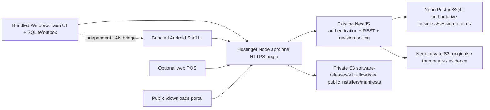

# Taha POS — full cloud and native release track

14 November 2026. This supersedes the earlier download-only/PHP hosting direction. Source is private at `jasonyade10techies-web/taha-pos`; current work is on `codex/cloud-native-release`. No production deployment, production DNS change, purchase or saved-shop database modification is part of this work.

## Verified status

| Category | Current evidence | Remaining gate |
|---|---|---|
| A. Ready to host | Existing combined React/NestJS architecture, real authentication, durable revision polling, guarded migrations/bootstrap and private media. Windows runner built actual NSIS/MSI with bundled API-mode UI. | Final package acceptance and target configuration are separate from implementation. |
| B. Configuration only | Same-origin origin, restricted database URL, JWT secret, private storage credentials, explicit trusted proxy, owner initialization and Hostinger Git branch. | Configure through private controls; no credentials in frontend or Git. |
| C. Code | New shared Windows/Android portal, durable software storage, signed-version Windows updater and guarded workflows implemented on this branch. | Full branch regression/review before promotion; historical packaged CI stall is not yet proven fixed. |
| D. External authorization | Existing approved Free Neon database and private S3 bucket are real and freshly verified. Authenticated Hostinger Node onboarding was observed. | Owner must finish Hostinger private-repository connection/slot settings. Protected native-signing environment is unsupported by the currently observed private GitHub Free plan; do not upload secrets or remove review gates. Production Authenticode certificate is not configured. |
| E. Physical acceptance | Compiled native artifacts and cryptographic verification exist. | Windows installation/startup/offline/reconnect/printing/second monitor, Android installation/cloud login/camera/resume, and real cross-device hosted acceptance remain unverified. |

## Architecture and source boundaries

Business data synchronization does not require new installers. Code updates require approved versioned releases. Private GitHub release links cannot be used as anonymous public downloads. Hostinger serves allowlisted release objects through the same HTTPS origin, without exposing bucket credentials or arbitrary object keys. Redeploying the Node application does not erase software releases or media.

Public routes: `/downloads`, existing `/downloads/taha-staff` and Android manifest/versioned APK routes, `/downloads/taha-pos/releases/staging.json`, `/downloads/taha-pos/updates/staging.json`, and versioned Windows files plus `.sig`. Missing/unverified channels report unavailable, rather than fabricated download links. Business APIs still require authentication. SPA fallback does not intercept `/api` or download failures.

`distribution/release-store.mjs`, `s3-store.mjs`, `s3-writer.mjs`, `software-handler.mjs`, `promotion.mjs`; `server/src/download-storage.ts` and `frontend.ts` implement these boundaries. Software writes use immutable object creation, full readback hash checks and ETag-conditional current metadata published last. Cloud objects are private; only approved software paths are anonymously streamed by the application. Metadata and executable transfers have size/time limits. Product/payment files do not enter the software prefix.

## Actual Windows artifacts

Native application version **0.5.1**, staging identity `com.tahamobiles.pos.staging`, separate AppData from production. Native source **`88fbace3d0175617f76657cce6a6a5d7b73a1030`**. Windows runner [43614758941](https://github.com/jasonyade10techies-web/taha-pos/actions/runs/43614758941) passed compilation/Rust tests and NSIS/MSI generation using Rust 1.99.0, MSVC and Windows SDK. No Windows compiler/SDK was installed on the owner's PC.

Verified installer files:

- `artifacts/windows-release-0.5.1/Taha-POS-Staging-0.5.1-x64-setup.exe` — 5,499,405 bytes; SHA256 `ae3a58f02749a588ade3a26a49a6f5e13b7d994f63aefb2657884a66ef284df5`.
- `artifacts/windows-release-0.5.1/Taha-POS-Staging-0.5.1-x64.msi` — 7,335,936 bytes; SHA256 `8dae352b54125384fd6cb433e1d9396ea89c05f186133cf766631b8b23851e7f`.
- Adjacent `.sig`, `release.json`, `sha256.txt` contain public verification material.

These have **Tauri updater signatures, not Authenticode publisher signatures**. Windows/SmartScreen trust and physical application behavior are not inferred from a successful build. The compiled default backend is the selected hPanel candidate `https://maroon-louse-575853.hostingersite.com`; it is not currently a verified running POS endpoint. Installing this candidate does not make unhosted login work.

`src-tauri/src/updates.rs` uses official updater 2.14.1, embedded staging public key, `requireSignedVersion:true`, HTTPS/same-origin channel paths, bounded downloads, SHA256 and a signed version. Installation re-verifies retained bytes and metadata, requires owner confirmation, and rejects pending local sales/photos or stored active carts. UI is Settings → About. Local shop data remains in AppData. No production update channel/key is silently inferred from staging.

Staging private signing material is retained outside the repository in owner-only recovery storage. Windows DPAPI protects the signing passphrase locally; an independent portable/off-machine signing recovery method is still required. The public key alone is committed. Do not change the key for an update to existing staging installations.

The second CI artifact also contained cached 0.5.0 installers. Those were preserved separately and excluded from the signed 0.5.1 package. The workflow now removes only regenerated CI installer output after restoring compiler cache and requires exactly the two current-version installers. This correction needs its own subsequent CI run.

## Android

Build **13 / 0.5R.3a-test** is retained without changing the APK/source/signing identity. `artifacts/android-release-R3A-build13/Taha-Staff-test-build13.apk`, 4,033,766 bytes; SHA256 `5fcc6dd868e3c582d19e3bea4680e4e1808170382299d460fbba28baf8441f01`. Test package `com.tahamobiles.staff.debug`; certificate SHA256 `fe4bd258ec8f80aa5aeb2fcc608e7fe42c2dd0af3931767ca8bfd84af3618a38`. Native camera/scanner/queue/pairing and Android-confirmed update installation remain intact. The APK was freshly inspected while packaging; no physical phone test occurred.

## Cloud dependencies actually verified

**Neon PostgreSQL 17**, project `taha-pos-staging`, Singapore region, database `taha_staging`. Base branch remains empty: zero owners/products/customers/sales/stock movements. Existing separate `r2c-acceptance-20261113` branch contains synthetic historical acceptance records only. Fresh read-only verification checked **69 migration checksums**, restricted pooled `taha_runtime` without superuser/RLS bypass/role creation, and certificate-verified TLS. No MySQL conversion or Supabase backend/auth is introduced.

**Neon private S3**, bucket `taha-staging-private`. This provider supports the application's exact-size signed HTML form POST contract, unlike providers supporting only presigned PUT. Fresh private object write/read/delete and anonymous denial passed. A second fresh software-storage probe passed immutable retry/collision refusal, ETag pointer compare-and-swap, pinned reads, stale-publisher rejection and anonymous denial; diagnostic objects were removed. No paid resources were created. Free staging quotas do not establish production capacity or SLA.

Secrets remain in protected local recovery/configuration and must be entered through hPanel/GitHub private controls, never pasted into chat. No new provider resource creation is required for this staging exercise. Production database/bucket/backup policy remains a separate decision.

## Verification and limitations

- Windows CI native build and one current native URL policy unit test passed. Bundled frontend metadata confirms `api` with mock authentication disabled.
- Backend fresh full suite: **284/284** after building the shared distribution modules. An earlier mistakenly parallel build/test command caused 15 missing-module hook failures; preserved as failed evidence, then corrected execution order and rerun without weakening assertions.
- Release-system tests: **25 passed** before final review; final counts recorded in the closing report.
- Last complete frontend CI at R3A `b9be0a3`: **199 passed, one intentional skip**. That entire CI job subsequently timed out in the separate packaged wizard check, so the overall run was not green. Do not represent those results as a complete run of this newer branch.
- A fresh local exact prior R3A package passed **26/26** compiled API/empty-shop/browser/financial/media/restart/restore checks. The wizard timeout was intermittent; progress logging and bounded route/check/owned-process cleanup were added. A subsequent new package must pass the added anonymous portal check too. No claim that timing instrumentation alone proves the old stall fixed.
- Test logs and provider proofs: `.test-postgres/cloud-native-20261114/`; synthetic fixture DBs are on guarded port 55459. Saved shop database 55439 remains unused. Recovered MediaService hash remains `b5db3723b534c0e00371a0f0d15a8289b20a12d58e0bcdb61622dc8d2b6c0d3f`.
- `artifacts/software-portal-0.5.1-build13.zip` contains a verified standalone download preview with EXE/MSI/APK/checksums/manifests/Android QR. It is **not** the full NestJS application or an actual hosted URL. The combined Hostinger source/package is separate.

## Account interaction and deployment status

Hostinger's actual official-domain Node onboarding was observed with temporary domain `maroon-louse-575853.hostingersite.com`, Git import and upload choices. This establishes a Node onboarding path, not remaining slot/resource entitlement, successful deployment, trusted proxy range or running API. The older connector's Business v3 inventory is not authoritative for the owner's selected Unlimited plan.

Computer Use was stopped because the current Windows browser URL could not be verified reliably. The owner then explicitly prohibited PC/browser/app control. Work resumed only through code/build commands; no further browser, mouse, keyboard or open-app interaction is authorized. Do not retry account UI automation as a workaround. Owner can complete the exact manual Git connection in the companion runbook.

No Hostinger deployment, public POS HTTPS acceptance, production release or physical hardware acceptance is claimed. Main/staging source promotion and native publishing remain gated, not automatically merged.

## Remaining controlled work

1. Finish full-branch regression, independent review corrections, final immutable full application packaging and restore/source backups.
2. Owner connects the private GitHub repository to the confirmed Hostinger Node slot and sets private environment configuration; verify slot limits/proxy/logs. Review/promote the exact accepted source into `staging` before enabling auto-deploy there.
3. Privately initialize the empty staging owner once; complete real hosted fresh-shop and shared desktop/mobile acceptance, uploads/redeploy/restart/polling/financial checks.
4. Install Windows staging and APK13 on real devices; validate offline SQLite/reconciliation, reconnect, LAN bridge, camera/process-recreation recovery, printing/HID scanner/second monitor.
5. Resolve repair-job parts/deposit/settlement accounting, production backup/restore schedule, native signing/secure CI custody and deployment/operational acceptance before daily shop use.

See `TAHA_POS_FULL_HOSTINGER_GITHUB_RUNBOOK.md` for configuration and workflow steps. Do not repeat R1 recovery or redesign approved UI during this hosting track.
