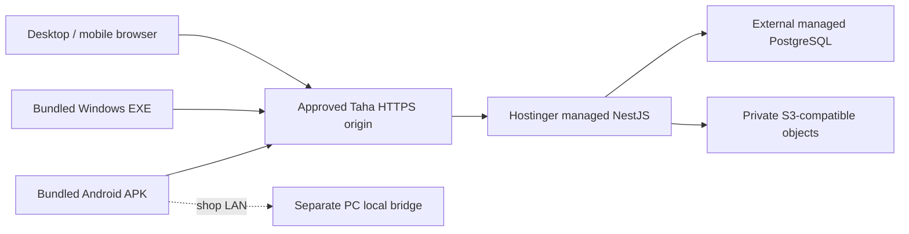

# Taha POS Hostinger deployment readiness

Audit: **11 November 2026**. Existing project: `D:\Inventory system POS`. **No deployment, purchase, service creation or production configuration change was performed.** This report preserves the custom NestJS/PostgreSQL architecture; it does not authorize a MySQL migration or a VPS assumption.

## R1 update — recovered backend and plan discovery

The initial audit below preceded PhaseR1. **MediaService has now been reconstructed; backend typecheck/lint/build and the complete isolated backend suite pass (203tests,0failures).** The running isolated API and frontend proxy return connected Taha health. These results do not constitute a deployment or production/hardware acceptance. Current recovery details are in `TAHA_POS_PHASE_R1_RECOVERY_REPORT.md`.

The signed-in browser Websites page now verifies a plan displayed as **Unlimited**, expiring **20October2027**. It offers Cloud Startup as an upgrade; it is not evidence of a VPS. The owner explicitly selected **this browser plan** for Taha. Current published Business/Unlimited limits include5Nodeapps,120processes/60entryprocesses; current-v6 documentation lists2CPU/3GBRAM/50GBstorage. Those are published defaults, **not a measured or account-specific resource entitlement**: Usage details could not be opened through the current native geometry interface.

The newly connected read-only Hostinger API returned a **different inventory**: one active `hostinger_business_v3` plan and7different websites, including3Nodeapps. It does not match the browser's two visible WordPress sites/Unlimited plan. Do not join those records, assume that its spare app capacity belongs to the purchased Unlimited plan, or deploy using that connector identity until account alignment is resolved. No IDs, credentials, sites or DNS were changed. This mismatch does not invalidate the directly observed plan name; it limits account/API automation and resource confirmation.

Recommended next hosting slice remains **one managed NestJS application serving the existing Vite bundle and `/api` on one HTTPS origin**, external managed PostgreSQL and private object storage. Static/SPA/API serving is a future bounded adaptation, not implemented byR1. Source recovery, HTTP polling, secure config/private storage and current build scripts can be reused. No real PostgreSQL/bucket/HTTPS Taha endpoint has been provisioned.

Official limits: [Node resources/limitations](https://www.hostinger.com/support/hostinger-node-js-limits-for-web-and-cloud-plans/), [current and version-dependent plan resources](https://www.hostinger.com/support/6976044-parameters-and-limits-of-hosting-plans-in-hostinger/). Node22/24 compatibility, no incoming WebSockets/always-running workers, external PostgreSQL and private-object requirements below still apply.

## Initial audit decision — superseded where noted above

At initial audit the backend could not build because MediaService contained33,538NULbytes. R1 resolved the source/build/full-backend regression blocker. No verified cloud database/private bucket/deployment exists, and the8October managed ZIP remains stale. The plan name is now verified as Unlimited in the owner-selected browser, with account-specific resource/API alignment still pending.

Recommended conditional target: **Hostinger managed Node.js + external managed PostgreSQL + private S3-compatible storage**, with a same-origin browser/API surface and database-backed HTTPS polling. A separate local bridge remains optional for shop LAN speed/offline connectivity. This recommendation becomes valid only after confirming the actual plan and database/provider requirements below.

## Initial audit account evidence — historical, superseded by R1 above

The signed-in hPanel Home was accessible during the audit, showing unrelated existing WordPress sites. The open VPS page showed setup/pricing offers rather than a verified active Taha VPS. No exact subscription/plan name was exposed by the successful observations. The computer-use tool then stopped further navigation because it could not verify the current browser URL with sufficient confidence. We did not work around that restriction, alter the account or change any site.

The owner's larger-plan purchase is accepted as owner-reported information, not proof of a particular product. To resolve: read the actual subscription/plan name and Node.js/Web Apps entitlement in hPanel plan details; note limits/region, not credentials. An AI-builder/WordPress/static-only product, Web/Cloud managed Node and VPS are different products. Existing unrelated domains are not approved Taha domains.

## Current official compatibility evidence

Checked using official Hostinger sources on 11 November. Product documentation can change; recheck at actual provisioning. These pages establish general capabilities, not entitlement of this specific account:

| Requirement | Official/provider statement and Taha implication | Account-specific status |
|---|---|---|
| NestJS/Vite and custom build | Eligible Business and Cloud plans support NestJS/Vite, source ZIP/Git build deployment and supported Node versions. Use the existing source, not a framework rewrite. [Deployment guide](https://www.hostinger.com/support/how-to-deploy-a-nodejs-website-in-hostinger/) | Browser plan is Unlimited, owner-confirmed. Account-specific entitlement and connector alignment remain unverified; no Taha app created. |
| Node version | Server engine is `>=22 <25`; choose supported22or24 and validate native argon2/sharp dependencies on Linux build. Same deployment guide. | No managed build executed. |
| Request-serving process | Managed Node supports a request-serving process with platform routing/PORT. Request ceiling120seconds. [Node limits](https://www.hostinger.com/support/hostinger-node-js-limits-for-web-and-cloud-plans/) | No runtime/timeout test. |
| Inbound WebSockets | Managed Web/Cloud Node does not accept inbound WebSockets. Use HTTPS polling; preserve local LAN sockets separately. Same limits source. | Cloud adapter exists, with repair/shift revision gap. |
| Workers/extra services | No always-running independent worker/custom port/Docker/Redis service assumption. Persist work and use supported bounded scheduled execution where required. Same limits source. | No worker needed for core correctness; cleanup schedule unaccepted. |
| Environment secrets | Runtime variables vs VITE build variables have distinct restart/redeploy behavior; environment history is not provider-backed. [Environment guide](https://www.hostinger.com/support/how-to-edit-or-add-environment-variables-after-deployment/) | No Taha production environment configured. |
| PostgreSQL | Managed included database is MySQL; external providers are allowed for other engines. [Database guide](https://www.hostinger.com/support/connecting-a-hostinger-mysql-database-to-a-node-js-application/) | No external PG resource/connectivity/role capability verified. |
| Persistent private media | Build/live deployment directories are replaced across deploys; do not use them as durable image storage. Deployment guide above. Private external object storage is the prepared architecture. | No bucket/provider credentials/CORS/lifecycle acceptance. |
| Scheduled tasks | Hostinger documents a Node.js cron tool; verify entitlement and bounded job behavior, never assume an endless timer survives deployment. [Cron documentation index](https://www.hostinger.com/support/hostinger-dashboard/cron-jobs/) | Not configured or verified in purchased plan. |
| Backups | Hostinger site backups and retention are documented. External PostgreSQL and private objects need their own policy and restore test. [Backup guide](https://www.hostinger.com/support/5981435-how-to-download-backups-at-hostinger/) | No Taha cloud backup/restore. |
| HTTPS/domain/Android | Must provide a real public HTTPS origin/certificate and explicit allowed origins. Android/native access uses normal HTTPS REST, not a Vite port. | No approved Taha domain/ingress accepted. |
| SSH/automation | ZIP/Git build supports managed deployment without root SSH; actual access/limits vary. Migration can run from a controlled admin environment. | R1 creates a local recovered-source Git baseline; no remote or deployment automation configured. |
| Concurrent connections | Plan resource/process limits are not a PostgreSQL connection budget. Small pool and provider pooling/role behavior need measured tests. | Default cloud pool2/max5per instance; no hosted load test. |

Do not treat a generic WordPress/MySQL backup or a plan marketing claim as PostgreSQL/private-object recovery.

## Existing code that can be reused

| Existing file/module | Purpose | Work still required |
|---|---|---|
| `server/package.json`, `scripts/build-managed.mjs`, `scripts/managed-start.mjs` | Build Nest plus compiled migration/provision tools; `npm start` listens platformPORT on0.0.0.0 | Source repaired and local build passes. Still require fresh package/install/build acceptance on managed Linux. |
| `scripts/package-managed.mjs` | Stages source/dist/migrations/package files without actual env/data/tests | Rebuild after recovery, inspect archive exclusion/content; old ZIP is not current. |
| `server/.env.managed.example` | Nonsecret environment names | Add/align current cloud options, actual public origins/secure provider config; never upload actual env or owner DB. |
| `server/src/config.ts`, `database/pool-options.ts` | Cloud HTTPS/private-storage guard, verified TLS, bounded pool | Set `TAHA_RUNTIME=cloud` explicitly on managed host; VERCEL auto-detection will not occur. Check all host normalization/provider TLS cases. |
| `realtime/polling.gateway.ts`, `sync/*`, frontend `lib/api/realtime.ts` | No socket/timer correctness dependence, ordered durable revisions | Add missing jobs/shifts stream and scope; verify cursor/retry/foreground behavior against hosting. |
| `src/lib/device-bridge/*`, camera DB heartbeat/REST | Cloud polling/presence and independent LAN bridge | Real phone cloud tests, companion HTTPS/CORS/trust, explicit separate LAN identity. |
| `media/file-storage.ts`, upload-grant migration/controller and `src/lib/api/direct-upload.ts` | Private S3 and exact-size short-lived browser upload transport | Restore MediaService; actual S3 POST support, CORS/private/read/write/delete/hash/expiry/ownership/restart test. |
| `server/scripts/migrate.ts` | Advisory lock, per-migration checksum, explicit schema creation and runtime role setup | Provider role/extension compatibility, backup and one controlled migration job. |
| `server/scripts/seed-staging.ts` | Approved isolated sample data, stable manifest and rerun safety | Actual staging resource approved; no real shop data import; secure owner provisioning. Fresh seed tests pass. |
| `scripts/build-cloud.mjs`, cloud frontend guards | API/real-auth staging bundle to`dist-staging`; no private-LAN/mock publish | Hostinger same-origin routing and build commands. |
| `server/vercel.json`, `server/api/index.js`, frontend generator | Vercel-specific routing/function support | Retain, but do not assume Hostinger consumes it or routes SPA/API correctly. |

`server/docs/API.md` documents existing endpoints. Development Swagger `/api/docs` is disabled in production. Older READMEs have stale ports/APK references; use current code and audited runbook.

## Recommended deployment shape

For simplest browser authentication, serve the existing Vite build and NestAPI at one HTTPS origin. The current API does **not** yet serve the frontend bundle. Adding ordered static/SPA handling around the existing Nest bootstrap is a bounded deployment adaptation: `/api` and missing assets must never return SPA HTML. Alternatively verify Hostinger can supply the required same-origin reverse proxy for two app roots. Do not presume Vercel JSON rewrites are portable. The cloud frontend currently enforces `/api/v1` and disallows an arbitrary absolute cloud API URL; cross-origin deployment needs deliberate code/auth testing.

Windows/Android UI remains bundled regardless of online browser hosting. Hosting does not compile the Windows application or make mobile offline cash complete.

### Option comparison

| Option | Reliability/compatibility | Complexity/cost boundary | Decision |
|---|---|---|---|
| A: Hostinger frontend/API + external PG + private objects | Fits existing Nest/PG/REST; no incoming socket requirement; managed app operations | Uses purchased eligible compute, plus database/storage/backup spend; multiple data providers require coordinated restore | Recommended if plan and external connectivity/roles verified. |
| B: Hostinger frontend + separately hosted API/PG | Preserves engine if purchased plan is static/unsupported | Extra API provider/cost and routing/session configuration; no free-tier uptime assumption | Valid fallback. |
| C: verified Hostinger VPS | Supports full process/ports/DB/socket control | OS/security/update/TLS/supervision/backup responsibility; may require a new product if not purchased | Only on explicit verified VPS decision, not assumed. |
| D: change PostgreSQL to Hostinger MySQL | Incompatible as a connection-string-only change | Rewrite RLS/PLpgSQL/identity/functions/locks/JSON/migrations, migrate data and revalidate every financial/race path | Not recommended; no migration begun or authorized. |

No exact price estimate is reliable without plan, region, PG backup tier and image volumes. Prefer reliable paid data retention/recovery over an unverified zero-cost sleeping stack for shop accounting. No services were purchased during audit.

## PostgreSQL deployment prerequisites

The database provider must support the actual code, not just a PostgreSQL URL:

- Custom `auth`, `storage`, `app_private`, `private`, `public` and migration schemas; UUID/jsonb/pgcrypto and current SQL functions/triggers/indexes.
- Migration identity capable of required extension/role creation, ownership and grants. `runtimeRole()` creates a dedicated login and grants `authenticated`; generic restricted web dashboards may not permit this.
- Runtime login NOSUPERUSER/NOBYPASSRLS/NOINHERIT, not schema owner. `Database.asActor()` uses transaction-local claims and `SET LOCAL ROLE authenticated`; verify pooled connections do not retain another actor and provider pool mode supports these semantics.
- Separate controlled migration secret; do not leave high-privilege credentials in public frontend or ordinary API if unnecessary.
- Verified server certificate TLS; cloud pool max2by default, max5per instance,8second connect timeout. Confirm aggregate hosting instances/provider connection budget.
- Backups/PITR/retention chosen for financial recovery, tested restore into disposable target.

Changing to MySQL would require a major engine/security/concurrency migration. Keep existing PostgreSQL functions and financial history until an explicit, independently planned decision says otherwise.

## Storage and upload acceptance

Use a **private** bucket and backend-only credentials. Current direct-upload design is SigV4 **form POST**, not a universal PUT API. Verify the selected S3-compatible service actually supports POST policies and required CORS; do not assume every compatible brand does. Browser posts contain no shop auth headers/cookies. Grant completion must recheck real bytes/type/size/hash/purpose/actor/shop/expiry before attachment, with idempotent capture identity. Those controller/transport/schema contracts exist, but the implementation in MediaService must first be recovered.

Test large file path, expired/cancelled/replayed grants, wrong user/shop, unrecognized payloads, concurrent completion, restart and retrieval. HeadBucket alone does not prove write/read permissions or safe private media. Plan stale staging-object cleanup, retention and backups. Do not delete payment evidence still referenced by financial records. No local Windows Temp directory or deploy-root upload folder is acceptable production durability.

## Secure configuration map — names only

Backend-only: `NODE_ENV`, platform`PORT`, `TAHA_RUNTIME`, `TAHA_DEPLOYMENT_ENV`, `PUBLIC_API_URL`, `FRONTEND_ORIGIN`, optional fixed`MOBILE_APP_ORIGIN`, `DATABASE_URL`, `DATABASE_POOL_MAX`, `JWT_SECRET`, `COOKIE_SECURE`, `STORAGE_DRIVER`, `S3_ENDPOINT`, `S3_REGION`, `S3_BUCKET`, `S3_ACCESS_KEY_ID`, `S3_SECRET_ACCESS_KEY`.

Controlled migration/provision runner: `MIGRATION_DATABASE_URL` and owner provisioning values; not frontendVITE variables. Prefer explicit one-shot migration; `MIGRATE_ON_START` exists but is not a substitute for an upgrade/backup/rollback procedure. No LAN certificate/key/discovery/download fixture should be configured on the cloud host.

Public frontend: `VITE_DATA_PROVIDER=api`, `VITE_USE_MOCK_AUTH=false`, `VITE_API_URL=/api/v1`, `VITE_DEPLOYMENT_ENV=staging` for staging; public endpoint/native build config only. No password/JWT signing/database/storage secret underVITE or insideAPK/EXE.

## Acceptance gates, in dependency order

1. Recover source, full build/lint/isolated custom API financial/auth/media regression; snapshot/private source baseline.
2. Confirm actual Hostinger plan, approved domain, Node version/runtime/resources and outbound PG/S3 connectivity. No purchase/deploy inferred from this document.
3. Approve isolated external PG/private objects, credentials custody and retention; verify role/extension/TLS compatibility before live data.
4. Package current source safely; configure same-origin frontend/API, secure session/cookie/origins, no cache/noindex for staging and no unexpected WebSocket dependency.
5. Backup/explicit checksummed migrations and owner provisioning in staging; no default test password or copied customer data.
6. Provider health/readiness including current schema/runtime permissions and private object write/read/delete; not just SELECT1.
7. Two-browser desktop/mobile login, product create/receive/sale, single stock deduction, partial credit/payment/reversal/return, receipt/PDF/customer QR, proof/private images, independent logout and persistence after restart/PC off.
8. Pause/restart/outage/poll reconnect/cursor continuity, no duplicate money/stock, appropriate permission denials, camera/device presence with a real phone.
9. Actual database+objects restore/rollback, monitoring/secrets recovery, then separate Windows/Android/hardware/offline pilot.

Owner must supply decisions, not secrets in chat: exact purchased plan, approved Taha domain, external database/object storage backup choice, physical test hardware and later native prerequisite authorization. Until then status is **PREPARATION EXISTS / BUILD BLOCKED / TARGET PLAN UNKNOWN / NOT DEPLOYED / NOT DAILY-USE READY**.
