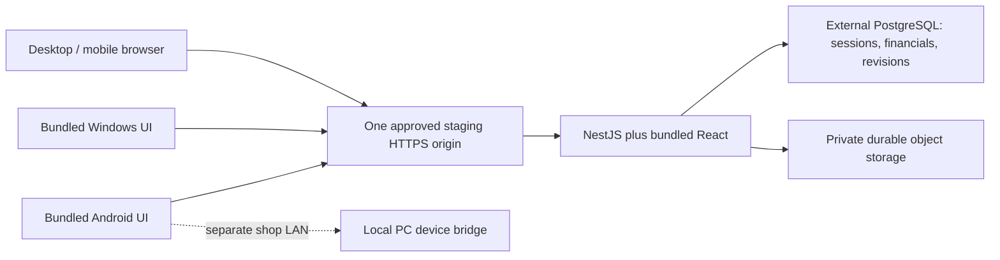

# Taha POS — Hostinger staging runbook (R2B)

Prepared 12 November 2026. **No deployment has been performed.** Execute deployment and target migrations only after the owner approves the actual target resources. Never run these steps against the saved development shop database.

## Architecture



Cloud correctness uses durable database revisions and HTTPS polling. The local LAN Socket.IO bridge remains available independently; the managed cloud process does not register incoming Socket.IO or endless presence workers.

## Preflight gates

- Confirm the owner's selected Unlimited plan, available Node slot, supported Node 22/24 runtime, build/start controls, logs, environment secrets and actual resource limits. Connector inventory currently differs; target entitlement remains UNKNOWN.
- Select the staging origin. Confirm managed HTTPS and the trusted proxy source/CIDR. Set no wildcard trust boundary.
- Provision a **new** staging PostgreSQL database, privileged migration identity and distinct restricted runtime identity; confirm `pgcrypto`, role/grant/RLS and `SET LOCAL ROLE` support, verified TLS and provider pooling semantics. No MySQL conversion.
- Provision a **private** durable object bucket. Confirm exact-size signed S3 form POST, bounded reads and write/delete permissions, approved-origin POST CORS, blocked anonymous reads and backup/retention policy. Do not store permanent files inside the deployable app directory.
- Choose an owner staging password privately. Samples must be synthetic; do not export saved shop records to staging.

General Hostinger restrictions and source links are recorded in `TAHA_POS_DEPLOYMENT_DEPENDENCIES.md`; they do not establish this account's purchased quota.

## Build the release locally

From `D:\Inventory system POS`, after a reviewed clean local commit:

```powershell
npm run package:managed
```

`scripts/package-r2b.mjs` forces real API authentication and `/api/v1`, builds React staging assets and compiled Nest/tools, emits an immutable file SHA256 manifest, rejects private/generated files and credential-like material, and produces a **new timestamped** directory and ZIP under `artifacts/managed/`. It never overwrites the October package or recovery archives. A dirty source tree is explicitly labelled uncommitted and is not the accepted release provenance.

The release has root `package.json`, lockfile, `server.cjs`, `verify-release.cjs`, `dist/`, `dist-tools/`, `migrations/`, `public/`, `smoke.mjs`, blank `environment.example` and operating instructions. It excludes node_modules, real environment files, databases, local photos/proofs, APK/signing material, private archives, source maps and development logs. `npm ci --omit=dev` installs production dependencies on the target platform; no Windows node_modules is uploaded.

## Managed application configuration

Use the existing eligible managed Node workflow, framework NestJS/Other as supported by the actual hPanel. Upload the reviewed ZIP with its contents at application root. Choose Node 22 or 24. Build command: **`npm run build`** (verifies precompiled release bytes). Start command: **`npm start`**; entry **`server.cjs`**. Respect platform-assigned `PORT`; one listener binds `0.0.0.0` by default.

Configure runtime values privately using `environment.example`. Mandatory: production/staging cloud mode, approved HTTPS frontend/public API origin, verified database/runtime URL, random JWT secret, private object credentials and explicit trusted proxy. `MIGRATE_ON_START=true` is rejected. Cloud mode rejects local permanent storage, private/LAN database endpoints and insecure TLS settings. Native Android origin must be enabled deliberately when APK access is accepted.

The frontend is bundled in the package; Vite is absent at runtime. GET/HEAD extensionless browser routes refresh to the SPA. API routes, unknown assets, dotfiles and writes never fall back to index.html. The bundle cannot silently become an unrelated demo when the API fails.

## Separate staging migration and seed

No migrations run during HTTP requests or web startup. Use a separately authorized bounded deployment/cron job if the plan provides it, or run the compiled tools from a secure administration computer that can reach the selected database.

Privately supply `TAHA_DEPLOYMENT_ENV=staging`, `TAHA_STAGING_DATABASE_APPROVED=true`, exact `TAHA_STAGING_DATABASE_NAME`, `MIGRATION_DATABASE_URL`, and separate `DATABASE_URL`. For a distinct provider pooling hostname explicitly approve `TAHA_STAGING_RUNTIME_HOST`; the runtime endpoint must then see the expected migrated database. Cloud tools verify PostgreSQL certificates; install the provider CA separately if needed. Do not set the local rehearsal mode on hosted staging.

```text
npm run migrate:staging
npm run seed:staging
```

Seed additionally requires private `STAGING_OWNER_EMAIL` and `STAGING_OWNER_PASSWORD`. It locks and transacts, refuses existing accounts/domain/media without a staging marker, creates linked sample products/stock/services/customer/cash/credit/return history, and returns the original dataset on repeat. It is not an import tool. Remove migration credentials, seed password and approval flags from normal application environment after the controlled job. Keep the restricted runtime identity only.

Migrations preserve byte checksums and ordering, including compatibility and imported legacy SQL. The R2B source currently contains **68** migrations; compute the manifest, do not permanently hardcode that count. Do not edit applied SQL or manually rewrite its registry checksum. Runtime gets read-only registry access; migration ownership remains separate.

## Health, readiness and smoke acceptance

- `GET /api/v1/health/live`: process liveness, no dependency probe, HTTP 200 while the process can respond.
- Existing `/api/v1/health`: compatibility connectivity check, explicitly `readiness:not-assessed`.
- `GET /api/v1/health/readyz`: cached sanitized summary, HTTP 200 `ready` or 503 `degraded`/`unavailable`; no provider secrets, schema details or raw errors.
- Authorized Owner/settings manager `GET /api/v1/health/ready?refresh=1`: explicit deep probe with named checks and migration counts. A connected but incomplete schema is **not** ready.

Deep checks cover startup/configuration, actual PostgreSQL connectivity/TLS, exact migration registry, required functions/pgcrypto, RLS and restricted runtime grants, authentication crypto/provisioning, and random private storage write/read/byte comparison/anonymous-denial/delete. Public concurrent probes share one flight and a short result cache; storage success is cached 60 seconds, failure 5 seconds. Explicit authorized refresh can force a fresh probe. Only generated diagnostic objects are touched.

```text
node smoke.mjs https://APPROVED-STAGING-DOMAIN
```

An optional short-lived `TAHA_SMOKE_ACCESS_TOKEN` enables authorized deep smoke inspection. Never put tokens in URLs or logs. Test direct nested refresh, failed API routes, owner login, separate desktop/mobile sessions, uploads/reload/restart, cash/credit/returns and revision catch-up with synthetic fixtures. Hostinger logs must contain no secrets. Rehearse actual provider TLS/POST/privacy, not only a local S3-contract fixture.

## Local production-style rehearsal

`scripts/test-r2b-package.mjs` runs the **actual packaged entry and compiled tools**, clean production dependencies, a newly named disposable PostgreSQL database and filesystem, and temporary loopback TLS. It never uses Vite or saved port 55439. Test certificates are not installed into Windows trust. This validates local package behavior; it does **not** certify Hostinger, live object storage, public certificates, Linux native binaries, Android or Windows hardware.

## Backup, rollback and recovery

Before applying any hosted migration, preserve the previous ZIP/hash, private environment version record, a PostgreSQL custom-format dump/PITR point, and independent object recovery/version history. Use `pg_dump` through a private connection environment or provider backup mechanism; do not put passwords in command arguments. Verify `pg_restore --list`, restore into a separate empty target, compare migration checksums/FKs/financial invariants and prove private files readable. Confirm provider roles/auth assumptions after restore.

For code rollback, use a schema-compatible previous artifact. Prefer a forward fix when schemas are incompatible. There are **no automatic destructive down-migrations**. Never reset or overwrite financial history to roll back the frontend. A database restore requires a separately approved recovery plan including post-backup transactions, receipt identifiers and object references. Do not delete the only recovery copy.

After restart/rollback verify liveness, deep readiness, login/session continuity, media retrieval, pending synchronization and idempotent transaction-result lookup. In a suspected financial failure, inspect the persisted idempotency result before repeating a charge.

## Actual deployment boundary

No app, domain, database or bucket was provisioned in R2B. No DNS, purchase, remote push or deployment occurred. The next approved phase should deploy **isolated staging only**, verify real target capabilities, then conduct shared computer/mobile and recovery acceptance. Daily production still needs the native, accounting, hardware and operational gates in the remaining-work checklist.
